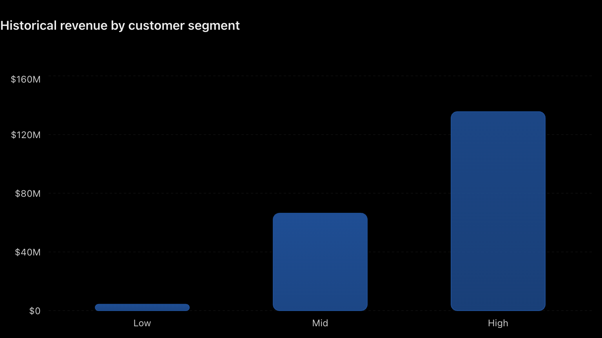
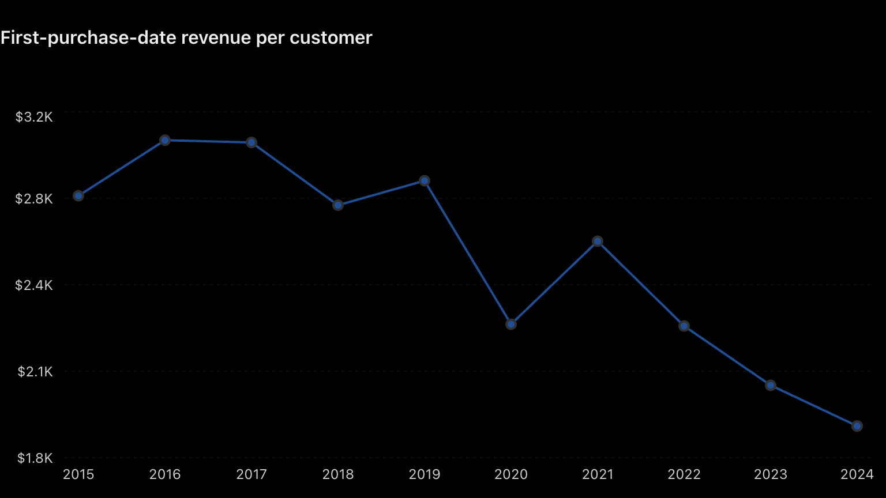
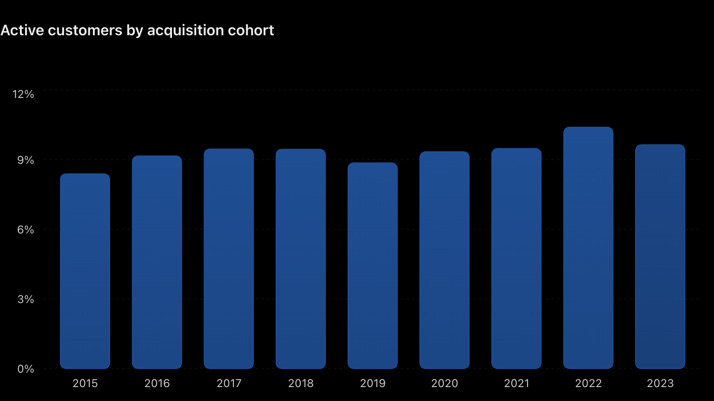

# Customer Analytics Using SQL: Segmentation, Cohort and Retention

## Introduction

This project analyzes customer purchasing behavior using the Contoso 100K dataset and PostgreSQL. The objective is to understand how customers contribute to revenue, how purchasing patterns differ across acquisition cohorts, and how customer activity changes over time.

Using SQL, I performed three analyses:

1. Customer Segmentation: Categorizing customers based on historical lifetime value (LTV).

2. Cohort Analysis: Examining customer acquisition trends and revenue generated on customers' first purchase dates.

3. Customer Retention & Churn Analysis: Identifying active and inactive customers based on their most recent purchase.

Together, these analyses provide insights into customer value, acquisition performance, and purchasing activity.

## Business Questions

The project focuses on three questions:

1. How is revenue distributed across low-, mid-, and high-value customers?

2. How do customer acquisition and initial purchasing behavior differ across yearly cohorts?

3. What percentage of customers remain active versus inactive under a six-month inactivity threshold?

## Repository Contents

| File | Description |
|---|---|
| `0_cohort_analysis_view.sql` | Creates the reusable `cohort_analysis` view used by all queries |
| `1_customer_segmentation.sql` | Low / Mid / High value segments by lifetime revenue |
| `2_cohort_analysis.sql` | Acquisition cohorts and first-purchase-date revenue |
| `3_retention_analysis.sql` | Active vs churned customers (six-month threshold) |
| `*.png` | Result charts shown below |

## Tools Used

- PostgreSQL: Database management and SQL query execution.

- SQL: Data cleaning, transformation, aggregation, and analysis.

- Visual Studio Code: Writing and organizing SQL scripts.

- Git & GitHub: Version control and project documentation.

## SQL Techniques

- Common Table Expressions (CTEs)

- Window functions (MIN() OVER, ROW_NUMBER(), SUM() OVER)

- Joins and aggregations

- Conditional logic (CASE WHEN)

- Percentile calculations (PERCENTILE_CONT)

- Date functions and interval comparisons

- Customer-level revenue calculations

## Dataset

The project uses the Contoso 100K dataset, containing retail sales transactions and customer information.

Two primary tables were used:

- sales: Customer transactions, order dates, quantities, net prices, and exchange rates.

- customer: Customer identifiers, names, ages, and geographic information.

A reusable SQL view named cohort_analysis was created to combine customer and transaction information.

The view includes:

- Customer identifiers and cleaned customer names

- Order dates and aggregated daily revenue

- Customer demographic information

- First observed purchase dates

- Acquisition cohort years

Revenue was calculated using quantity, net price, and exchange rate. Transactions were aggregated by customer and order date.

This view served as the foundation for all three analyses

## How to Run

1. Load the Contoso 100K sample database into PostgreSQL.
2. Run `0_cohort_analysis_view.sql` to create the `cohort_analysis` view.
3. Run queries `1`, `2` and `3` in order.

## Analysis & Findings

### 1. Customer Segmentation

Customers were segmented according to their cumulative historical revenue using the 25th and 75th percentiles.

Three segments were defined:

- Low-Value: Customers below the 25th percentile.

- Mid-Value: Customers between the 25th and 75th percentiles.

- High-Value: Customers above the 75th percentile.

The analysis calculated total historical revenue, customer counts, and average historical LTV for each segment.

**Results**

**Key Findings:**

- Approximately 49,487 customers generated $206.27 million in historical revenue.

- High-value customers represented approximately 25% of the customer base but contributed 65.7% of total revenue.

- Low-value customers represented approximately 25% of customers but contributed only 2.1% of revenue.

- Revenue was highly concentrated among customers with greater cumulative purchasing value.

### 2. Cohort Analysis

Customers were grouped into acquisition cohorts based on the year of their first observed purchase.

The analysis examined:

- Number of customers acquired per year

- Revenue generated on customers' first purchase dates

- Average first-purchase-date revenue per acquired customer

Only transactions occurring on each customer's first purchase date were included in the revenue calculation.

**Results**

**Key Findings**

- 2016 recorded the highest average first-purchase-date revenue per customer, approximately $3,035.

- 2022 had the largest acquisition cohort, with 9,010 customers.

- First-purchase-date revenue per customer was lower in 2023 and 2024 than in several earlier cohorts.

- Approximately $127.88 million in revenue was associated with customers' first purchase dates.

### 3. Customer Retention & Churn Analysis

Customers were classified according to their latest observed purchase date.

A customer was defined as:

- Active: Their most recent purchase occurred within the final six months of the dataset.

- Churned: Their most recent purchase occurred more than six months before the dataset's latest sales date.

To allow a full six-month observation period, customers whose first purchase occurred within the final six months were excluded.

This analysis measures inactivity at the end of the observation period rather than traditional month-by-month cohort retention.

**Results**

**Key Findings**

- Approximately 90.5% of eligible customers were classified as inactive under the six-month threshold.

- Only 9.5% of eligible customers made a purchase within the final six months.

- The 2022 acquisition cohort had the highest active customer rate at approximately 10.4%.

- The 2015 cohort had the lowest active customer rate at approximately 8.4%.

- Active customer rates were relatively similar across the eligible acquisition cohorts.

## Key Takeaways

This project provided several insights into customer purchasing behavior:

1. Revenue concentration: The highest-value 25% of customers generated approximately 65.7% of historical revenue.

2. Acquisition differences: Customer acquisition volume and first-purchase-date revenue varied across yearly cohorts.

3. Customer inactivity: Approximately 90.5% of eligible customers were inactive under the six-month threshold, highlighting an opportunity to investigate purchasing frequency and customer re-engagement.

## Limitations & Future Improvements

Several considerations are important when interpreting the findings:

- Customer LTV represents historical observed revenue, not predicted future lifetime value or profit.

- Cohort revenue measures purchases occurring on customers' first purchase dates rather than cumulative cohort revenue.

- The six-month churn threshold is an analytical assumption and may not reflect the business's actual customer lifecycle.

- The analyses are descriptive and do not establish the causes of customer behavior.

Potential future improvements include monthly cohort retention analysis, customer purchase frequency analysis, and Tableau dashboards to visualize customer behavior.

## Conclusion

This project demonstrates how SQL can be used to analyze customer purchasing behavior and answer business-related questions.

By combining customer segmentation, acquisition cohort analysis, and inactivity classification, the analysis provides a foundation for understanding customer value and engagement.

The results illustrate how transactional data can be transformed into insights that support further investigation into customer retention, revenue concentration, and customer purchasing patterns.